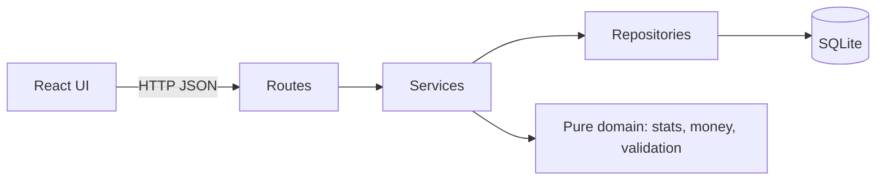

# Design

## Stack
Node 20 + TypeScript, Fastify, better-sqlite3, Zod, Vitest. React + Vite + TypeScript on the front end.

## Layers

- **Routes**: parse/validate input (Zod), map to HTTP.
- **Services**: business rules, transactions (e.g. salary update + history row).
- **Repositories**: SQL only.
- **Domain**: pure functions (median, currency conversion) that are trivially unit-tested.

## Data model
- `employees(id, first_name, last_name, email UNIQUE, job_title, department, country, currency, salary_minor, hire_date, status)`
- `salary_history(id, employee_id, old_salary_minor, new_salary_minor, changed_at, reason)`
- `fx_rates(currency PK, usd_per_unit)`
- Indexes: country, department, job_title, last_name.

## Key decisions
- **Integer minor units** for money to avoid float errors.
- **Aggregates in SQL** (and a pure median helper) so the UI never downloads 10k rows.
- **Server-side pagination** with whitelisted sort columns.
- **SQLite**: zero-ops and allowed by the brief; Postgres is the upgrade path past a single node.
- **In-memory DB per test** for fast, isolated tests.
